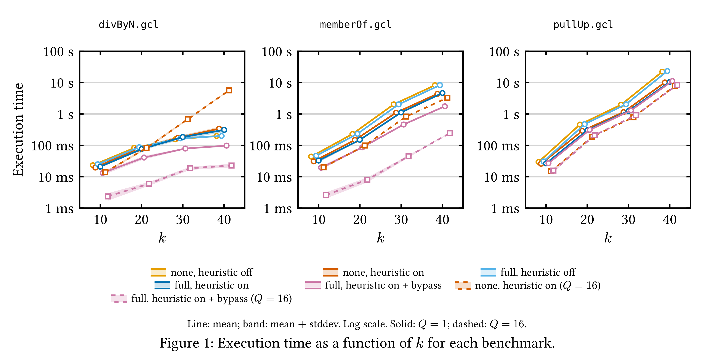
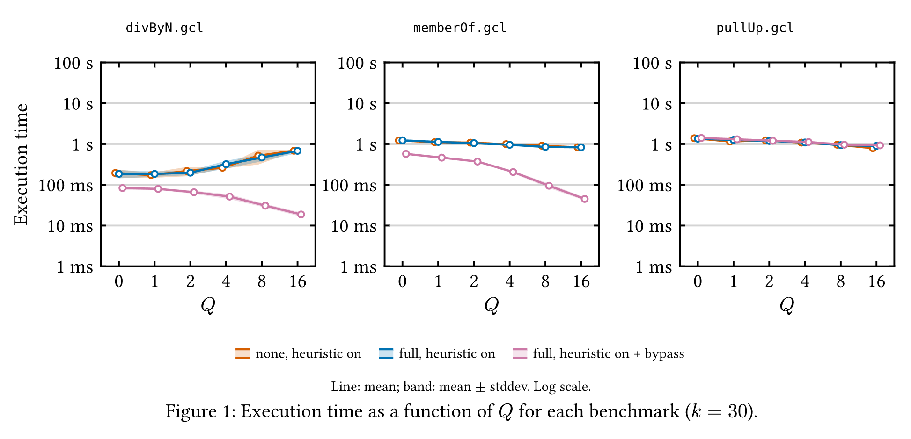
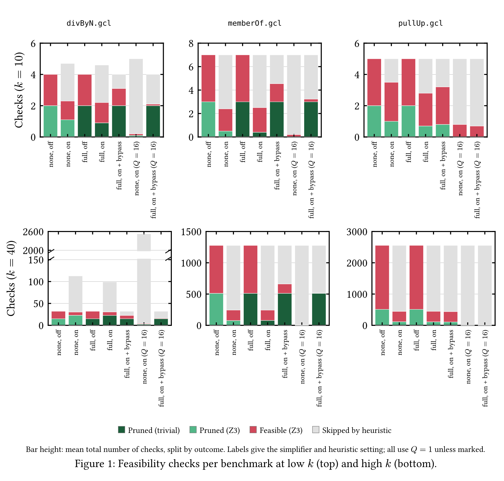
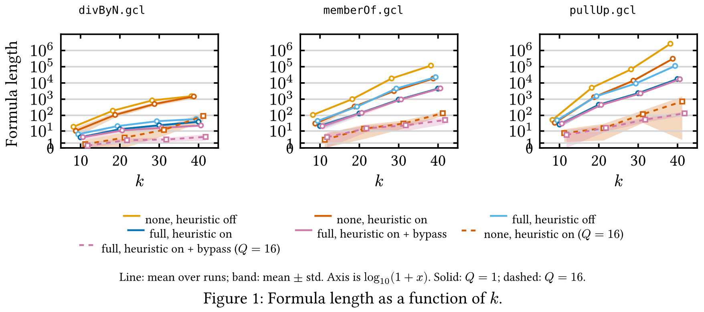

<style>
  :root {
    --color-background: #272e33;
    --color-foreground: #d3c6aa;
    --color-highlight: #67b8e3;
    --color-dimmed: #859289;
  }
  marp-pre {
      background: #2f383e;
      code {
          color: #859289;
      }
  }
</style>


# **INFOPSV - GCL Bounded symbolic checker**

Pepijn Bakker - Iris Scheepstra - Konstantinos Tsikouris


---

# **Contents**
- General structure
- Simplifier
- Heuristic
- Results
- Conclusion


# **General structure**
- Unrolling branches into lazy tree
- Truncate to max path length (k)
- Depth first exploration (favor staying in loops)

# **General structure - WLP + Feasibility**

# **General structure - Z3**

# **Simplifier**
- constant folding
  - integer folding limited
- chain simplification + normalization
  - inspects maximal and/or chains
  - absorption, deduplication, unit removal, annihilation


# Chain simplification + normalization


```hs
-- | Set-level normalisation of one maximal AND/OR chain
normChain :: Expr -> Maybe Expr
normChain e = case e of
  (_ :|| _) -> go (B True)  (B False) mkOr  orView  absorbOr  e
  (_ :&& _) -> go (B False) (B True)  mkAnd andView (collapseLowerBounds . absorbAnd) e
  _         -> Nothing
  where
    go ann unit mk view absorb x
      | ann `elem` xs = Just ann          -- annihilator present; x -> ann
      | y == x        = Nothing           -- x was already normal; report no change
      | otherwise     = Just y            -- x -> y
      where xs = view x
            y  = mk                  -- reconstruct tree
               $ absorb              -- apply absorption
               $ nub                 -- remove duplicate terms
               $ filter (/= unit) xs -- remove units
```
--- 
# Heuristic
- Simplifier off, simplifier on in a limited state, simplifier fully on
- Probability based heuristic
  - Fully on, fully off, and possibility to always check with at least the simplifier.
- Deeper = lower chance
- Q value adjust how fast this drop off happens

---
# Results - first experiment
<!-- Here we can see the mean execution times on 3 of the benchmarks-->


- For these benchmarks, there is a clear winner:
Full simplifier, heuristics on with Q=16, and always feasibility 
checking with at least the simplifier.
- Comparison of full vs no simplifier

---
# Results - effect of Q

- Clear winner once more
- Increasing Q has opposite effects in divByN
- Showcases importance of the simplifier

--- 
# Results - number of feasibility checks needed



--- 
# Results - number of feasibility checks needed

- 